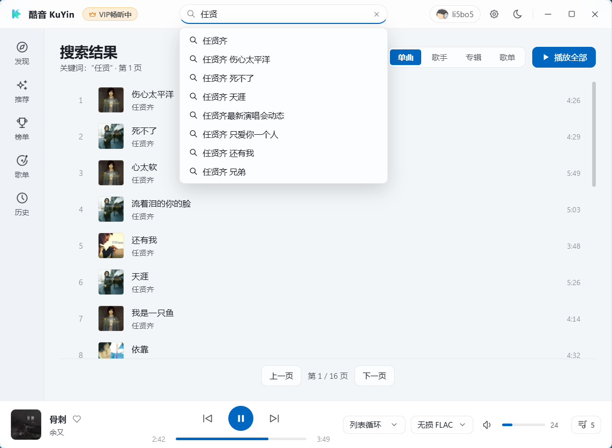

# 酷音 KuYin

<p align="center">
  
</p>

<p align="center">
  <strong>基于 Tauri 2 + Rust + Vue 3 驱动的 Windows 11 极简超低内存酷狗概念版音乐播放器</strong>
</p>

<p align="center">
  <a href="#-内存与性能表现"></a>
  <a href="#-核心技术栈"></a>
  <a href="#-核心技术栈"></a>
  <a href="#-核心技术栈"></a>
  <a href="#-系统要求"></a>
  <a href="https://github.com"></a>
</p>

---

## 📖 项目简介

**酷音 KuYin** 是一款专为 Windows 11 打造的轻量级桌面音乐客户端。项目深度整合**酷狗概念版全网曲库**，采用「100% 状态在 Rust 后端 + 无状态遥控器前端」的前后端职责隔离架构，底层通过系统原生 `Windows.Media.Playback.MediaPlayer` 进行硬件加速解码，**彻底告别 Electron 的百兆甚至上千兆内存膨胀**，还你一个极致纯粹、轻盈高效的听歌体验。

---

## 🖼️ 界面展示

| 主页面 · 发现与播放 | 全网搜索 · 联想检索 |
|:---:|:---:|
|  |  |

| 设置中心 · 性能管理 | 原生系统托盘 · 紧凑控制 |
|:---:|:---:|
|  |  |

---

## 极致性能与低内存杀手锏

-  **双级窗口休眠机制（兼顾 0ms 秒开与托盘零 WebView2 占用）**：
  - **第 1 级休眠（任务栏）**：调用 WebView2 原生 `TrySuspend()` 挂起渲染页内存页。
  - **第 2 级休眠（系统托盘）**：**彻底销毁 WebView2 进程组**；后台由纯 Rust 核心独立维持流式播放，**常驻总内存仅 12 MB ~ 18 MB，CPU 占用接近 0%**！。
-  **驱动**：直接调用 Windows 11 内置 `MediaPlayer` 硬件加速解码与原生 HTTP `Range` 流式缓冲，实现体积与内存双极简。

---

## ✨ 核心功能全览

### 0. 特殊功能
- **输出检测**：支持检测系统音频设备插拔（蓝牙/有线/耳机/音箱），输出设备发生改变时，自动播放暂停，输出设备恢复时，自动恢复播放。
- **音量联动**：音量滑动至 0 自动进入暂停，拉高音量自动恢复播放。
- **快捷搜索**：实时搜索，上下键选择，Enter确认，Esc回退。

### 1. 海量曲库与播放体验
- **音质切换**：支持 Standard 标准 (128K)、High 高品质 (320K) 与 FLAC 无损音质动态切换。
- **FM  漫游**：基于偏好算法推荐，播完当前批次自动静默续拉下一批新曲，支持一键红心收藏与不喜欢跳过。
- **歌单发现**：精选分类歌单广场，分页自适应网格展示，一键进入歌单详情。
- **热门榜单**：同步官方权威排行榜（飙升榜、TOP500、热歌榜等），支持一键手动同步最新榜单与「播放全部」。
- **个性推荐**：每日清晨依据听歌口味更新专属定制曲目。
- **多维检索**：支持搜索联想建议词、单曲列表、歌手、专辑、歌单分类卡片。
- **歌词跟随**：，支持点击任意歌词行精准 Seek 定位。
- **播放队列**：支持查看当前播放队列、双击切歌、曲目上下微调移动、移除单曲、分页展示与一键「清空队列」。

### 2. 账号体系与 VIP 福利
- **多方式极速登录**：
  - 💚 **微信扫码登录**（接入官方开放平台 OAuth，手机微信扫一扫即可登录）
  - 💙 **酷狗扫码登录**（支持酷狗音乐 / 酷狗概念版 App 扫码）
  - 📱 **手机短信验证码登录**
  - 🔑 **账号密码登录**
- **云端歌单实时同步**：一键同步酷狗账号收藏与「我喜欢」歌单，支持自建歌单新建与管理。
- **每日自动签到领 VIP**：账号登录后，软件每次启动自动静默执行概念版 VIP 签到领取。

### 3. 系统集成与深度交互
- **Windows SMTC 系统媒体控制**：原生深度集成 Windows 11 媒体传输控件，键盘媒体键（播放/暂停、上一曲、下一曲）全局硬件响应。
- **全局媒体快捷键**：支持隐藏到后台托盘后通过全局热键随时控制（播放/暂停、切歌、音量调节、主窗口唤醒/隐藏），支持用户自由修改键位。
- **Win32 原生精致托盘菜单**：深浅色自适应的高质感 Fluent 菜单，包含歌曲封面、播放按钮栏、播放模式（顺序/列表循环/单曲循环/随机播放）无缝选择。
- **多显示器与拔插自愈**：窗口坐标尺寸实时记忆，启动与唤醒时自动校验当前有效显示器工作区，防止副屏拔出后窗口飘移越界。

### 4. 外观与数据管理
- **Windows 11 Fluent 实色设计**：支持浅色模式与深色模式无缝切换。
- **自定义数据与缓存目录**：支持用户在设置中一键迁移存储目录至其他磁盘，启动时自动回收超过 3 天的临时 HTTP 缓存。
- **数据库自愈与备份**：内置 SQLite WAL 模式，启动自动执行 `integrity_check` 与 `.bak` 热备份自愈机制。

---

## 📊 内存与性能实测数据

> 测试环境：Windows 11 23H2 / 24H2 · 64 位 · Release 构建 (`KuYin.exe`)

| 运行状态 | KuYin (Tauri 2 + 原生 MediaPlayer) | 传统 Electron 音乐客户端 |
| :--- | :---: | :---: |
| **启动静置 2 分钟** | **~ 38 MB** | 180 MB ~ 300 MB |
| **前台连续播放 10 首 + 歌单漫游** | **~ 55 MB** | 350 MB ~ 600 MB |
| **最小化到任务栏 (第 1 级休眠)** | **~ 32 MB**  | 200 MB ~ 400 MB |
| **关闭到系统托盘 (第 2 级休眠)** | **12 MB ~ 18 MB**  | 120 MB ~ 250 MB |

*不同系统测试数据有所出入，以实际为准*

---

<details>
  <summary> <h2>开发构建</h2> </summary>

## 🛠️ 核心技术栈

- **桌面框架**：[Tauri v2](https://v2.tauri.app/) (Rust 核心宿主)
- **底层解码**：Windows 11 原生 `Windows.Media.Playback.MediaPlayer` 
- **前端视图**：[Vue 3](https://vuejs.org/) + [Pinia](https://pinia.vuejs.org/) + [TypeScript](https://www.typescriptlang.org/) + [Vite](https://vitejs.dev/)
- **样式规范**：原生 Windows 11 Fluent Design（纯 CSS 变量，零第三方组件大包）
- **本地存储**：SQLite 3 (`rusqlite`) · WAL 模式

---

## 💻 本地构建指南

### 环境准备
1. 操作系统：Windows 10 / Windows 11 (64 位)
2. 安装 [Node.js](https://nodejs.org/) (建议 LTS 18+ 或 20+)
3. 安装 [Rust](https://www.rust-lang.org/) 工具链 (`rustup default stable-x86_64-pc-windows-msvc`)
4. 确保安装了 Visual Studio C++ 生成工具 (MSVC)

### 构建步骤

```powershell
# 1. 克隆本仓库
git clone https://github.com/li5bo5/KuYin.git
cd KuYin

# 2. 安装前端依赖
npm install

# 3. 运行本地开发环境
npm run tauri dev

# 4. 编译 Release 便携版可执行文件
npm run build
cargo build --manifest-path src-tauri/Cargo.toml --release
```

编译完成的独立可执行文件位于：
`src-tauri/target/release/kuyin.exe`

</details>

---

## 🙏 开源致谢 (Acknowledgments)

本项目在开发过程中参考并受益于以下优秀的开源项目，特此向原作者及社区贡献者致以诚挚感谢：

- **[MakcRe/KuGouMusicApi](https://github.com/MakcRe/KuGouMusicApi)**：提供了详尽的酷狗音乐概念版接口规范与通信协议参考。
- **[hoowhoami/EchoMusic](https://github.com/hoowhoami/EchoMusic)** 与 **[iAJue/MoeKoeMusic](https://github.com/iAJue/MoeKoeMusic)**：为本项目的部分交互体验与产品功能设计提供了宝贵灵感。

---

## ⚖️ 免责声明 (Disclaimer)

1. **非商业纯技术学习用途**：本软件完全免费开源，仅供个人编程学习、Rust / Tauri v2 原生桌面架构研究与技术交流使用，**不涉及任何商业化运营或盈利行为**。
2. **合规与正版尊重**：本软件仅作为第三方客户端界面实现，**不提供任何破解收费音乐、绕过版权鉴权或下载 VIP 专享无损音频的功能**；用户播放的曲目权益完全取决于其自身登录账号在官方平台的合法授权。
3. **版权归属说明**：本软件所展示的所有音乐资源、音频流直链、歌词文本及专辑封面等全部内容的知识产权，均归原版权所有方及对应平台所有。
4. **侵权处理**：请广大用户支持正版数字音乐。若任何版权方认为本项目存在不当之处或侵犯了您的合法权益，请通过 Issue 与我们联系，我们将在收到通知后第一时间予以配合移除或处理。

---

## 📄 开源许可证

本项目基于 [MIT License](LICENSE) 协议开源。
